# Kairos

*Le suivi de colis de la justice.*

Un colis commandé en ligne, ce sont trois messages : il est parti, il est en route, il est arrivé. Une femme dont la cour d’appel vient d’annuler la protection, c’est parfois aucun. Kairos est une brique d’intelligence artificielle qui se branche sur Cassiopée, le logiciel des tribunaux judiciaires pour la procédure pénale, afin qu’une décision de justice arrive à chaque personne qu’elle concerne, au bon moment, et qu’on puisse le prouver.

*Kairos* signifie « le bon moment » en grec. Projet gagnant du hackathon Droit × Microsoft, octobre 2026. Ce dépôt réunit tout ce qui concerne le projet : le dossier, la présentation, le prototype, la vidéo, la documentation et l’historique de notre travail. Toutes les données sont fictives.

  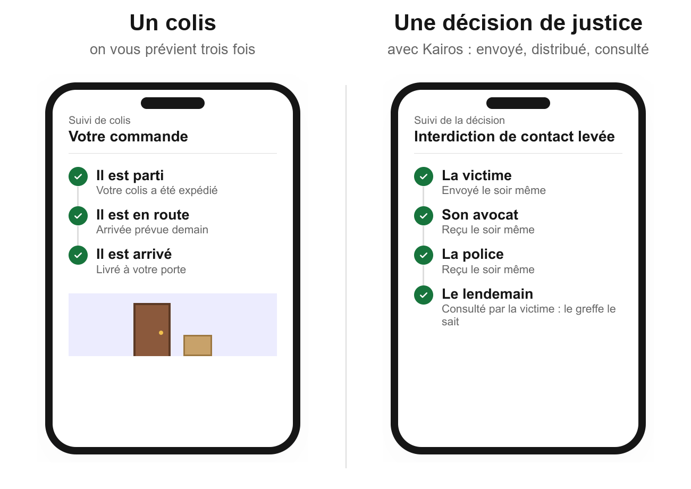

À voir tout de suite : [le dossier rédigé](Kairos-dossier-redige.pdf) (contexte, solution, pitch), [la présentation](Kairos.pptx), [la vidéo de démonstration](demo/video-demo.mp4) et [le prototype](demo/kairos.html), à ouvrir dans un navigateur après avoir cloné le dépôt.

Sommaire :

- [Le contexte](#le-contexte)
- [Ce que nous avons observé](#ce-que-nous-avons-observé)
- [Notre solution](#notre-solution)
- [Pourquoi ces choix](#pourquoi-ces-choix)
- [Comment Kairos répond au cadre du hackathon](#comment-kairos-répond-au-cadre-du-hackathon)
- [Au-delà des violences conjugales](#au-delà-des-violences-conjugales)
- [Le prototype](#le-prototype)
- [La présentation](#la-présentation)
- [L’équipe](#léquipe)
- [Documentation](#documentation)
- [Contenu du dépôt](#contenu-du-dépôt)
- [Limites et points ouverts](#limites-et-points-ouverts)
- [Sources](#sources)

## Le contexte

Le hackathon Droit × Microsoft a eu lieu en octobre 2026. Chaque équipe disposait de 5 minutes de pitch devant un jury composé surtout de juristes, ce qui a fixé notre manière de présenter : le moins de technique possible, un seul passage technique, et une démonstration d’une minute. Le sujet imposait quatre règles de conception : validation humaine avant toute modification, journalisation des accès et des modifications, protection des données des justiciables, échanges fondés sur des standards ouverts. Elles ont pesé sur toutes nos décisions, y compris sur ce que Kairos refuse de faire.

Nous sommes partis d’une idée plus large, qui s’appelait d’abord Vigie puis Chronos : une tour de contrôle qui suit toutes les procédures liées à une même affaire (pénal, ordonnance de protection, divorce, assistance éducative) et signale ce qui cloche. Au fil des deux jours, nous avons resserré sur un point précis, là où les chiffres de l’Inspection générale de la justice montrent un trou : l’information de la victime.

La question de départ était : comment transformer la lourdeur procédurale en levier d’efficacité au service de l’état de droit ? Une fois le terrain choisi, elle se ramène à ceci : comment garantir que chaque décision qui touche une victime lui parvienne au bon moment, et le prouver ?

## Ce que nous avons observé

Une affaire de violences conjugales ne vit pas dans un seul logiciel. Au tribunal, la procédure pénale est enregistrée dans Cassiopée, un traitement créé par l’article 48-1 du code de procédure pénale et les articles R. 15-33-66-4 et suivants. Selon la CNIL, il accompagne toute la vie de la procédure « afin d’améliorer le délai de traitement des procédures, et d’assurer l’information des victimes ». Autour, le juge aux affaires familiales utilise un logiciel civil, l’administration pénitentiaire le sien, la police et la gendarmerie les leurs. Ils ont été conçus séparément et communiquent mal.

Dans son rapport de décembre 2025 sur le traitement judiciaire des violences intrafamiliales, l’Inspection générale de la justice (IGJ) en tire trois constats : des données saisies plusieurs fois, donc fragiles ; une charge administrative lourde pour les greffes ; des informations qui ne circulent pas d’un service à l’autre. Le dossier commun créé pour ces affaires, SISPoPP, est peu utilisé, précisément parce qu’il faut tout y ressaisir.

Ce sont les victimes qui en paient le prix. Une décision qui touche à leur sécurité (sortie de prison de l’auteur, remise en liberté, annulation de leur protection en appel) doit leur être notifiée : la loi l’impose. En pratique, cela dépend de chaque tribunal et de la vigilance de chacun. L’IGJ a interrogé 152 tribunaux judiciaires :

| Décision | Tribunaux qui déclarent informer la victime |
|---|---|
| Libération de l’auteur en fin de peine | 95,4 % |
| Libération dans le cadre d’une permission de sortir | 86,2 % |
| Remise en liberté au stade de la détention provisoire | 79,6 % |
| Refus de placement en détention provisoire | 59,2 % |
| Ordonnance de protection infirmée en appel | 55,3 % |

Le rapport dit « systématiquement et immédiatement » pour les trois premières situations. La phrase sur le dernier chiffre est ambiguë dans le texte dont nous disposons ; nous la lisons comme les autres, voir [les points de vigilance](docs/points-de-vigilance.md). Le pitch retient les deux extrêmes.

Plus une décision traverse de services, moins elle arrive. Ces chiffres sont en outre déclaratifs : ils rapportent ce que les tribunaux disent faire, pas ce que les victimes reçoivent. Dans aucun cas, personne ne sait si la victime a réellement eu l’information. Aujourd’hui, on suit mieux un colis qu’une décision de justice.

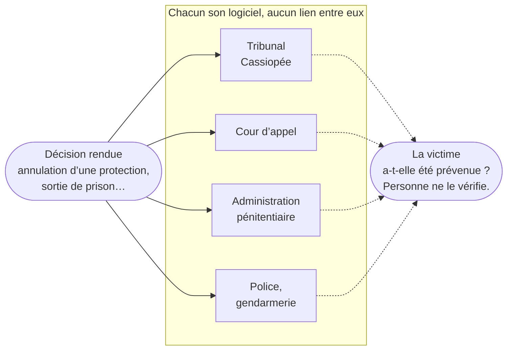

## Notre solution

Kairos ne remplace aucun logiciel et n’en ajoute pas un de plus. C’est une application web, hébergée dans un cloud souverain, qui se branche sur ceux qui existent. Elle rend effective une mission que Cassiopée porte déjà, l’information des victimes, en la prolongeant au-delà de ses murs et en apportant la preuve qu’elle a été remplie.

### Trois fonctions

**1. Fiabiliser les données.** Kairos lit les procès-verbaux et les décisions et en extrait les informations clés : qui, quoi, quand, avec les adresses et les téléphones des personnes et les mesures prononcées. Il vérifie que rien ne manque : mentions obligatoires, coordonnées à jour, délais, risques de nullité (une notification absente, une adresse ancienne, un numéro manquant, un délai qui approche). S’il détecte un manque, il alerte le greffe ou le magistrat, qui décide. On ne prévient pas quelqu’un avec une adresse périmée : tout commence par là.

**2. Interconnecter les services.** Une information saisie une fois est partagée avec tous les services qui en ont besoin : tribunal, cour d’appel, prison, police. Plus de ressaisie, plus de versions différentes d’un service à l’autre. Pour chaque type de décision, des règles juridiques disent qui doit être prévenu, en vertu de quel texte et dans quel délai. C’est la ressaisie qui explique le faible usage de SISPoPP : Kairos part du principe inverse.

**3. Notifier automatiquement.** C’est le cœur du projet. Kairos prépare un message clair, en mots simples. Un agent du greffe le valide d’un clic, puis il part. Chaque envoi est ensuite suivi comme un colis : envoyé, distribué, consulté quand c’est techniquement possible. S’il n’aboutit pas à temps, le greffe est alerté ; il vérifie les coordonnées ou contacte la victime autrement. On ne suppose plus que l’information est passée : on le sait.

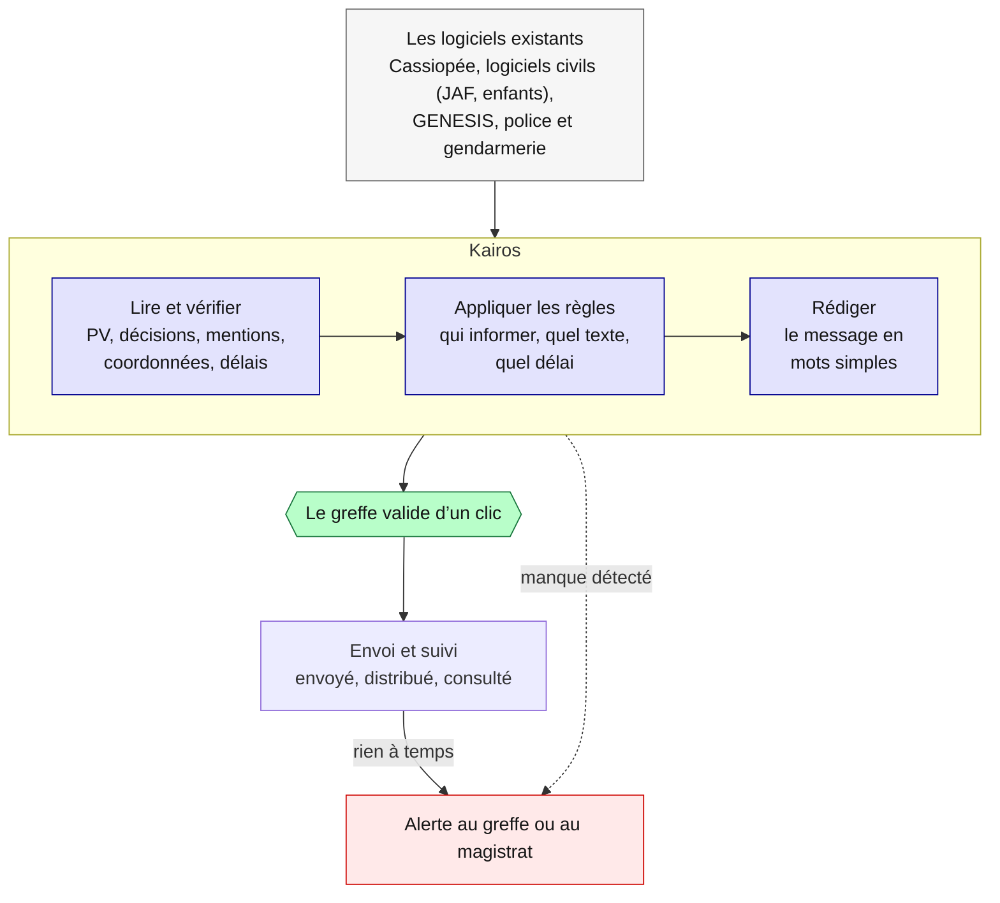

Le partage des rôles tient en une ligne : l’IA propose, le greffe valide, la plateforme envoie et prouve.

| Qui | Ce qu’il fait |
|---|---|
| L’IA | Lit les PV et les décisions, en extrait personnes, adresses, téléphones, dates et mesures, vérifie les mentions obligatoires et les délais, rédige le message. Elle propose. |
| Le greffe | Valide chaque envoi d’un clic, reçoit les alertes, appelle la victime quand un message n’aboutit pas. |
| La plateforme | Relie les logiciels, applique les règles juridiques, envoie après validation, suit chaque message, alerte, garde la trace de tout. Elle prouve. |

### Un exemple

Le cas du pitch : une femme a porté plainte contre son ex-conjoint, et un juge lui interdit de l’approcher. Quelques mois plus tard, la cour d’appel annule cette interdiction.

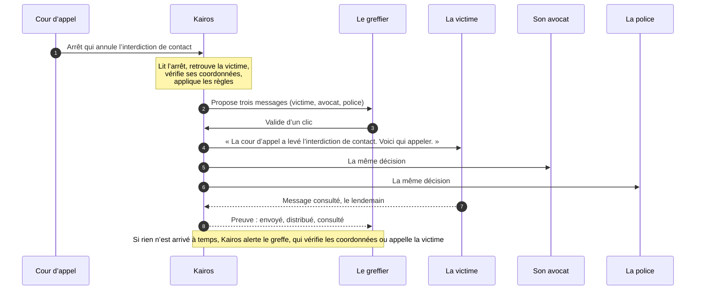

Le même mécanisme joue avant une sortie de prison. Un détenu, poursuivi ou condamné pour violences conjugales, demande sa mise en liberté. Kairos n’attend pas la décision : dès la demande, il ouvre le dossier, retrouve la victime, vérifie son adresse et son dernier numéro de téléphone, et rappelle que l’interdiction de contact est toujours en vigueur. Si la liberté est accordée, il affiche les personnes à prévenir (la victime, son avocate, le commissariat de son quartier) et le greffier valide un message du type « Il sort le 20 octobre. Il n’a pas le droit de vous contacter. En danger, appelez le 17. » La victime est prévenue en amont, pas le jour où elle le croise. Si elle n’a pas lu le message la veille de la sortie, le greffe est alerté et l’appelle.

### Le suivi, comme un colis

Chaque message a un statut, visible du greffe. C’est ce qui manque aujourd’hui : on sait qu’une décision a été rendue, rarement ce qu’elle est devenue.

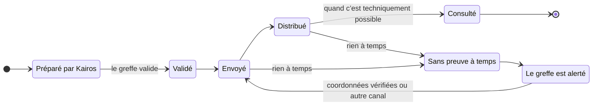

## Pourquoi ces choix

Le 15 octobre, notre mentor, avocat, à qui nous avons présenté le concept, nous a mis en garde : les victimes déménagent, changent de numéro, changent d’avocat. Un message envoyé au mauvais endroit peut être plus dangereux qu’un message qui ne part pas. Cette remarque a changé la conception, comme le montre la quatrième ligne du tableau.

| Choix | Pourquoi |
|---|---|
| Une brique branchée sur Cassiopée, pas un nouveau logiciel | Cassiopée porte déjà l’information des victimes dans ses finalités. Kairos prolonge cette mission au lieu de la dupliquer. Et un outil qui oblige à tout ressaisir finit peu utilisé, comme SISPoPP. |
| Le greffe valide chaque envoi | Un message adressé à une victime a des conséquences qu’une machine n’apprécie pas. C’est aussi la logique de l’article 22 du RGPD et de l’article 47 de la loi Informatique et libertés pour les décisions fondées sur un traitement automatisé. |
| Un suivi jusqu’à la consultation | On sait aujourd’hui ce qui est parti, jamais ce qui est arrivé. Avec une alerte à temps, le greffe peut vérifier les coordonnées ou joindre la victime autrement. |
| Adresses datées et sourcées, téléphone en priorité, confirmation au moindre doute | Les coordonnées d’une victime changent. Kairos garde chaque adresse avec sa date et sa source, ne devine jamais, et demande confirmation dès qu’il hésite. |
| Pas de note, pas de score | Kairos signale ce qui manque. Il n’évalue aucune personne et ne qualifie aucun acte : le greffe ou le magistrat apprécie. |
| Commencer par les violences conjugales | C’est là que l’enjeu est le plus grave. Le mécanisme ne dépend pas du cas : il vaut pour toute décision qui doit parvenir à quelqu’un. |
| Un outil interne à l’État, dans un cloud souverain | Ce sont des données d’enquête et de victimes : secret de l’enquête, protection des données. |

## Comment Kairos répond au cadre du hackathon

| Contrainte du sujet | Notre réponse |
|---|---|
| Validation humaine avant toute modification | Kairos propose, le greffe valide d’un clic. Rien ne part sans cette validation. L’IA ne décide, ne note et ne qualifie rien. |
| Journalisation des accès et des modifications | Chaque action est journalisée : lecture, validation, envoi, accusé de réception, avec l’auteur, l’heure et la source. Le prototype montre ce journal. |
| Protection des données des justiciables | Conception : pas de duplication des dossiers (Kairos garde des références et un journal), droits par rôle pour que chacun ne voie que ce qui sert sa mission, authentification forte des agents, adresse protégée d’une victime jamais réutilisée dans un acte, hébergement souverain. Rien de cela n’est implémenté dans le prototype, voir [sécurité et données](docs/securite-et-donnees.md). |
| Standards d’échange ouverts | Conception : connecteurs par API documentées, formats structurés (JSON ou XML), identifiant commun de dossier et d’événement, avec la source, l’auteur et la version de chaque donnée. |

Pistes d’architecture avec les briques Microsoft

Ce sont des pistes, pas une architecture arrêtée. L’hébergement et le choix des services restent à fixer avec le ministère, sous exigence de souveraineté.

| Besoin | Brique envisagée |
|---|---|
| Lire les PV et les décisions (PDF, scans) | Azure AI Document Intelligence |
| Extraire, vérifier, rédiger le message | Azure OpenAI, dans Azure AI Foundry |
| Retrouver les dossiers liés à une même personne | Azure AI Search |
| Brancher les logiciels existants | API Management, Logic Apps, Event Grid |
| Validation du greffe et alertes | Application web, notifications Teams ou Outlook via Power Automate |
| Traçabilité (source, auteur, version) | Dataverse, Microsoft Purview |
| Identités et droits | Microsoft Entra ID |

## Au-delà des violences conjugales

Nous commençons par les victimes, là où l’enjeu est le plus grave, mais le même moteur vaut pour toute décision qui doit parvenir à quelqu’un, et pour la fiabilité de chaque procédure, dont il vérifie les étapes et les délais. Pour mesurer le problème ailleurs, nous avons analysé 440 460 décisions de cours d’appel publiées sur Judilibre, l’open data de la Cour de cassation (janvier 2022 à septembre 2026) : 12 371 appels y sont déclarés caducs, souvent pour un délai manqué. Nous avons vérifié la lecture à la main sur un échantillon : 23 résultats justes sur 24.

Nous proposons un pilote de six mois dans un tribunal : trois mois pour mesurer la situation actuelle, ce que les chiffres déclaratifs de l’IGJ ne disent pas, puis trois mois pour mesurer l’effet de Kairos.

## Le prototype

`demo/kairos.html` est un fichier unique : on l’ouvre dans un navigateur, sans installation ni connexion. Il simule l’écran de Claire L., greffière d’un tribunal fictif (Valmont). Une date de libération arrive de l’administration pénitentiaire. Kairos retrouve les quatre procédures qui concernent la même personne, applique les règles, prépare six actions et rédige l’avis à la victime. La greffière le relit, coche les trois vérifications et valide. Les captures ci-dessous suivent les quatre onglets : Pilotage, Affaire R. / M., Actions, Vigilance.

Pour le parcourir en une minute :

1. Dans Pilotage, cliquer sur la première alerte rouge (la libération de M. R.).
2. Dans Affaire R. / M., cliquer sur « Analyser l’impact », puis sur « Voir les 6 actions ».
3. Dans Actions, l’avis à la victime est déjà ouvert : cocher les trois vérifications, puis cliquer sur « Valider l’avis ».

« Réinitialiser la démo », en bas de page, remet tout à zéro.

### Pilotage : ce que Kairos a repéré depuis ce matin

Le résumé de l’IA en tête, puis les alertes, classées « à traiter », « à vérifier » et « pour information ». Chaque alerte dit d’où elle vient (le logiciel et le point de contrôle) et à quel service elle s’adresse. Il n’y a ni note ni classement : seulement des alertes.

  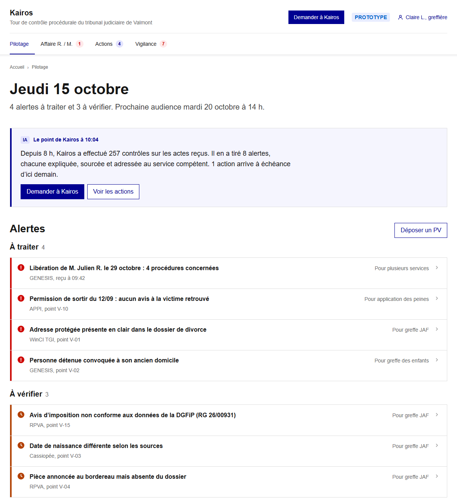

<em>Le point de Kairos et les alertes du jour, avec leur source et leur destinataire.</em>

Les audiences à venir se lisent comme des cartes de calendrier : en touchant l’une d’elles, on ne voit que les affaires qui posent problème, sous forme d’étiquettes (pièce absente, détenu à convoquer, adresse protégée). Les affaires en règle sont seulement comptées.

  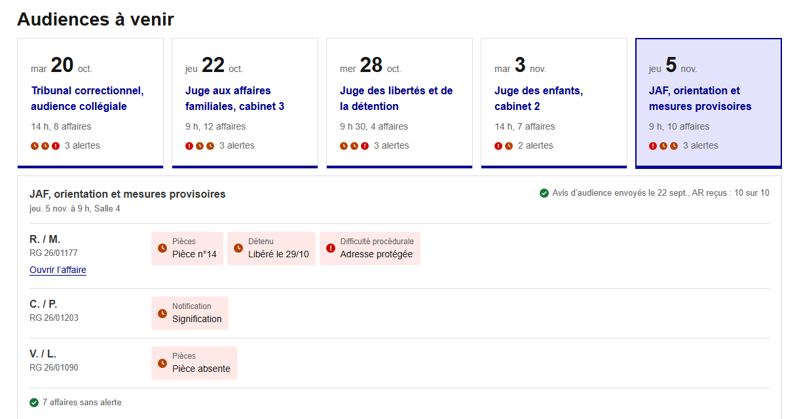

<em>Les cinq prochaines audiences et leurs points de vigilance.</em>

### Affaire R. / M. : relier les procédures

Les quatre procédures d’une même personne (pénal, ordonnance de protection, assistance éducative, divorce) vivent dans trois logiciels. Le bouton « Analyser l’impact » déroule cinq étapes visibles, de la lecture de l’événement jusqu’à « ce que Kairos n’a pas fait » : aucun envoi, aucune mesure modifiée, aucun contact avec la victime ni les enfants.

  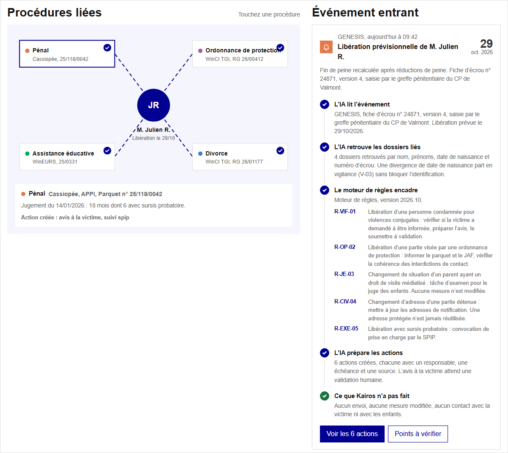

<em>Kairos retrouve les quatre procédures liées à la même personne et détaille ce qu’il a fait, étape par étape.</em>

La chronologie met sur une même ligne du temps les événements des quatre procédures, les avis envoyés à la victime (en vert), ceux qui manquent (en rouge) et ceux qui attendent une validation. Chaque événement renvoie à sa source.

  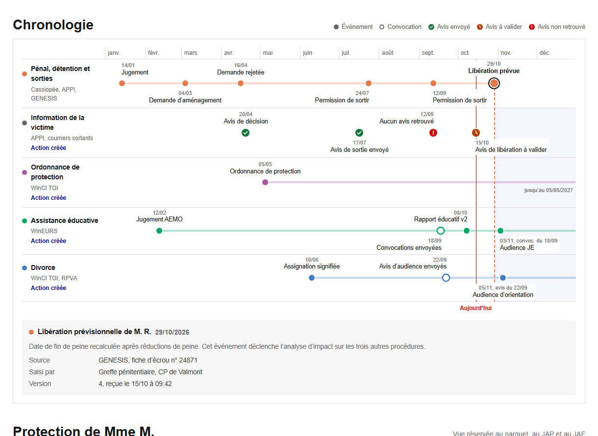

<em>La chronologie de l’affaire : libération prévue le 29 octobre, avis à la victime, convocations.</em>

Le bloc « Informer la victime : où le risque se situe » reprend les cinq chiffres de l’IGJ et dit, pour chaque situation, ce que Kairos déclenche.

  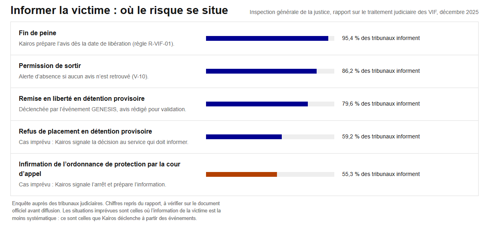

<em>Les chiffres de l’IGJ et ce que Kairos déclenche dans chaque cas.</em>

Chaque donnée de l’affaire porte sa source et un niveau de fiabilité (« certifiée par la source », « vérifiée », « déclarative »). Une divergence, ici la date de naissance, part en alerte sans bloquer l’identification.

  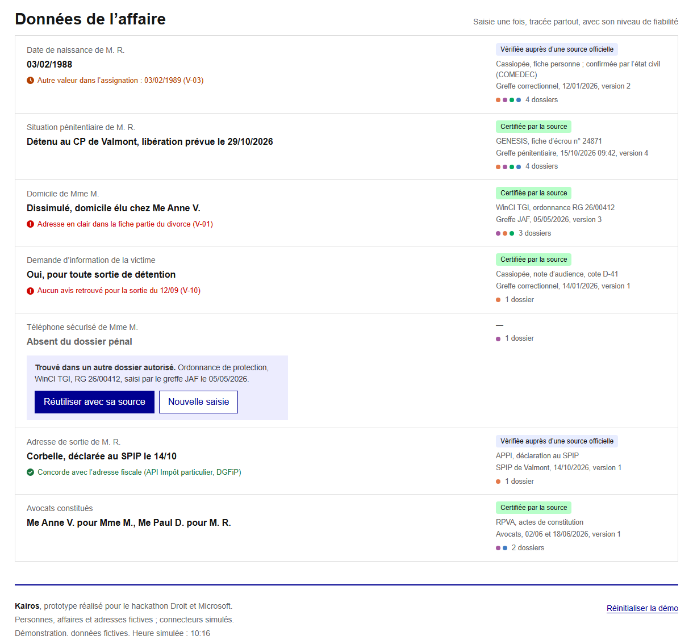

<em>Une donnée saisie une fois, avec sa source, sa version et son niveau de fiabilité.</em>

Un bloc explore le cas où la victime déménage : une carte sans aucune adresse (seulement des communes et des distances) et quatre contrôles. Il ne fait pas partie du pitch, voir [les pistes explorées](docs/pistes-explorees.md).

  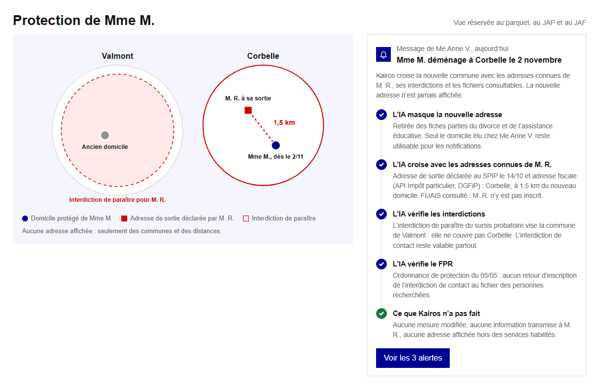

<em>Le déménagement de la victime : seulement des communes et des distances, jamais d’adresse.</em>

### Actions : l’IA prépare, la greffière valide

L’avis à la victime est rédigé en mots simples. Il ne peut être validé qu’après trois vérifications : la victime a demandé à être informée, l’envoi part chez son avocate et non à l’adresse protégée, le projet est relu. La validation est horodatée et versée au journal.

  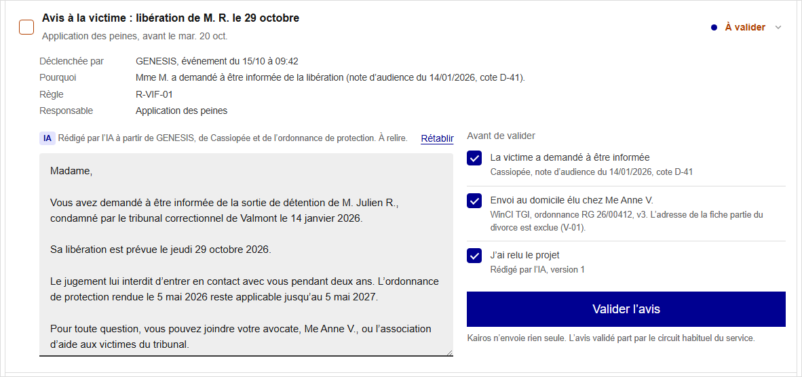

<em>La greffière relit le message rédigé par l’IA, coche les vérifications et valide. Kairos n’envoie rien seul.</em>

### Vigilance : lire un acte, signaler ce qui manque

On dépose un procès-verbal (ici un exemple de placement en garde à vue). L’IA surligne ce qu’elle a lu (heures, personnes, actes), passe sept contrôles, et constate qu’aucun avis au procureur n’y figure. Elle ne dit jamais « nul » : elle montre les sources et le magistrat apprécie.

  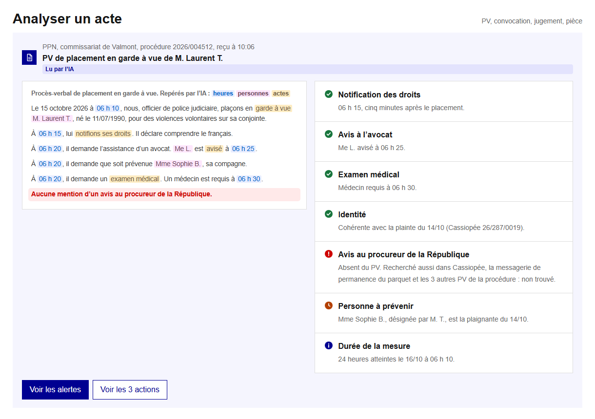

<em>Le PV lu par l’IA : sept contrôles, dont un avis au procureur introuvable.</em>

Avant d’alerter, Kairos cherche l’avis dans les autres applications. L’alerte montre ensuite le PV et les recherches face à face, la conséquence possible (article 63 du code de procédure pénale), ce qu’il faut vérifier, et qui prend en charge. Sans prise en charge, elle monte au magistrat de permanence.

  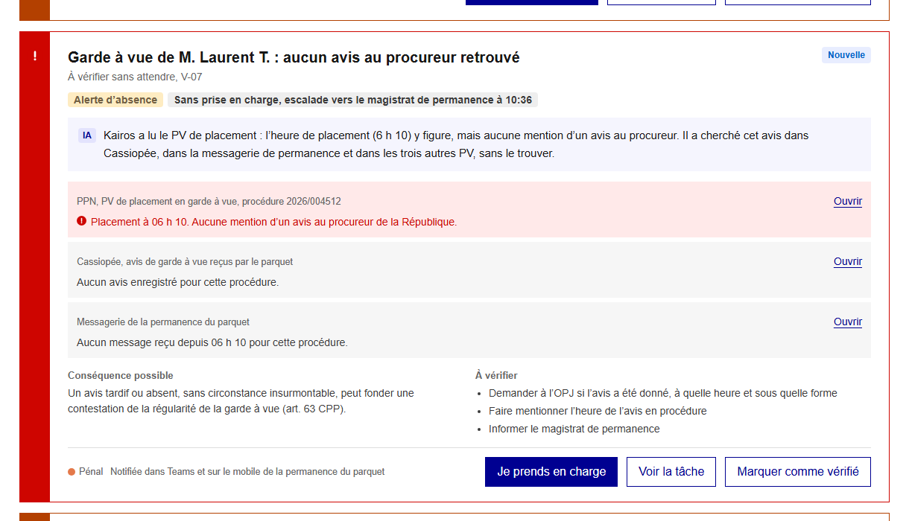

<em>Une alerte complète : explication, sources, conséquence possible, vérifications, prise en charge.</em>

### La vidéo

La [vidéo de démonstration](demo/video-demo.mp4) dure 41 secondes, sans son : les alertes du jour, les audiences à venir, l’affaire R. / M. avec ses quatre procédures et sa chronologie, les données de l’affaire avec leur source, puis la lecture d’un procès-verbal de garde à vue qui se termine sur l’alerte « aucun avis au procureur retrouvé ». Elle ne montre ni l’analyse d’impact ni la validation de l’avis ; le détail, avec le parcours conseillé pour la refaire, est dans [docs/demo.md](docs/demo.md).

### Ce que le prototype n’est pas

Le prototype a été construit avant la version finale du pitch, et il faut le lire comme une maquette :

- Il simule une libération annoncée par la prison, pas l’annulation en appel du pitch.
- Le suivi « envoyé, distribué, consulté » n’y est pas encore : il est montré dans la présentation, à la diapositive 10.
- Il contient des modules explorés en route qui ne font pas partie de la solution présentée : un assistant de questions, le déménagement de la victime, des croisements avec des fichiers et des sources officielles (impôts, état civil, FIJAIS, FPR). La base légale de ces croisements reste à établir, voir [les pistes explorées](docs/pistes-explorees.md).
- Aucun logiciel judiciaire réel n’est connecté, et rien n’est envoyé : après validation, l’avis est seulement « transmis au circuit d’envoi ».

## La présentation

`Kairos.pptx` compte 13 diapositives, avec les notes de l’orateur et la vidéo de démonstration intégrée. `presentation.html` en est la version pour navigateur : flèches pour avancer, N pour les notes de l’orateur, S pour le sommaire, F pour le plein écran. Le pitch dure environ 4 minutes 30, démonstration d’une minute en plus ; son texte est aux pages 3 et 4 du dossier rédigé et dans [docs/pitch.md](docs/pitch.md), avec le déroulé diapositive par diapositive.

Le déroulé complet est dans [docs/pitch.md](docs/pitch.md). Quelques diapositives pour en donner l’idée :

  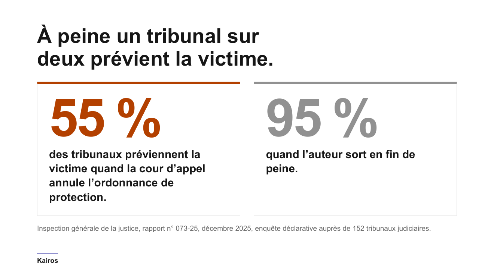

<em>Diapositive 3, les faits : à peine un tribunal sur deux prévient la victime quand la cour d’appel annule la protection.</em>

  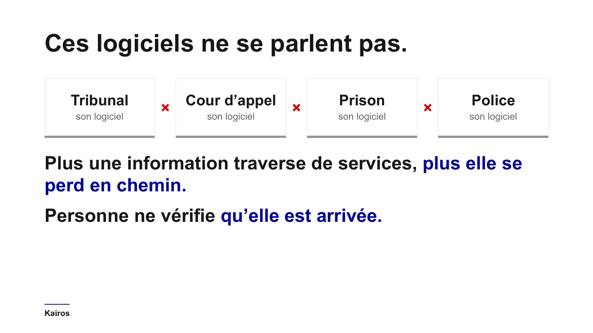

<em>Diapositive 4 : chacun son logiciel, et personne ne vérifie que l’information est arrivée.</em>

  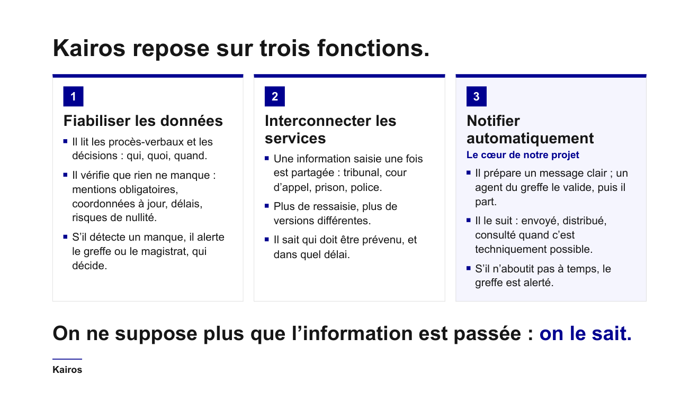

<em>Diapositive 7 : les trois fonctions, dont la troisième est le cœur du projet.</em>

  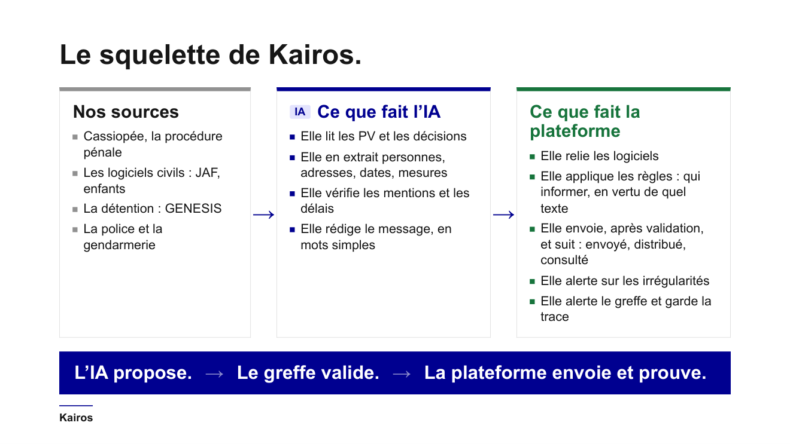

<em>Diapositive 8, la seule diapositive technique : l’IA propose, le greffe valide, la plateforme envoie et prouve.</em>

  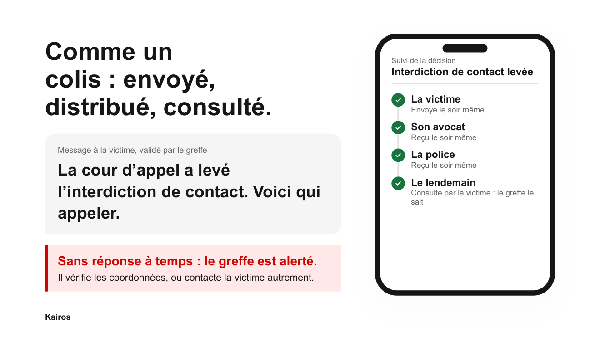

<em>Diapositive 10 : le suivi d’une décision, comme celui d’un colis.</em>

  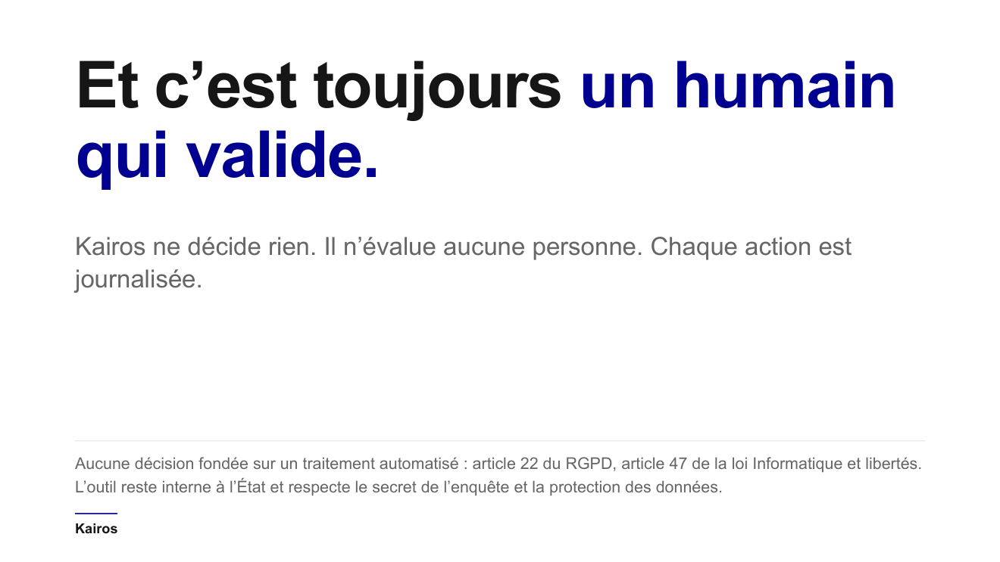

<em>Diapositive 12 : un humain valide, toujours.</em>

## L’équipe

L’équipe souhaite rester anonyme : aucun nom n’apparaît dans ce dépôt. Elle réunit deux profils hybrides, à la croisée de l’ingénierie et du management, des profils juridiques, et un mentor, avocat. Le mentor est aussi l’expert dont la remarque, le 15 octobre, a changé la conception.

## Documentation

Ce dépôt est la seule source du projet : tout ce qui a été écrit ou décidé pendant le hackathon y est, dans l’état final ou dans les archives.

| Document | Contenu |
|---|---|
| [docs/dossier.md](docs/dossier.md) | Copie texte du dossier rédigé (pages 1 et 2 du PDF) |
| [docs/pitch.md](docs/pitch.md) | Le texte du pitch, le déroulé des 13 diapositives, deux courts pitchs |
| [docs/demo.md](docs/demo.md) | Le prototype, la vidéo, le parcours conseillé, les scripts de commentaire |
| [docs/securite-et-donnees.md](docs/securite-et-donnees.md) | Les quatre contraintes, sécurité et protection des données (conception), cadre juridique |
| [docs/questions-reponses.md](docs/questions-reponses.md) | Les questions attendues du jury et les réponses |
| [docs/points-de-vigilance.md](docs/points-de-vigilance.md) | Ce qui reste à vérifier, les écarts entre livrables, les décisions en suspens |
| [docs/pistes-explorees.md](docs/pistes-explorees.md) | Ce qui a été essayé puis écarté, et pourquoi |
| [docs/historique.md](docs/historique.md) | La chronologie des deux jours, les consignes de l’équipe, les principes de conception |
| [docs/glossaire.md](docs/glossaire.md) | Sigles et termes |
| [archives/](archives/README.md) | Toutes les versions précédentes (Vigie, Chronos, premières présentations Kairos) et les textes d’origine |

## Contenu du dépôt

| Chemin | Contenu |
|---|---|
| `Kairos-dossier-redige.pdf` | Le dossier rédigé : contexte, problème, solution, garanties, sources, et le texte du pitch |
| `Kairos.pptx` | La présentation PowerPoint, avec la vidéo intégrée et les notes de l’orateur |
| `presentation.html` | La même présentation, pour navigateur |
| `demo/kairos.html` | Le prototype cliquable |
| `demo/video-demo.mp4` | La vidéo de démonstration |
| `docs/` | La documentation ci-dessus, et `docs/img/` pour les images de ce README |
| `archives/` | Les versions précédentes et les textes d’origine |

## Limites et points ouverts

- Les chiffres de l’IGJ sont déclaratifs. Notre analyse de Judilibre ne porte que sur les décisions publiées, avec un contrôle manuel sur un échantillon réduit.
- « Consulté » n’est mesurable que si le canal le permet, d’où la réserve « quand c’est techniquement possible ».
- Les règles juridiques par type de décision (qui informer, en vertu de quel texte, dans quel délai) restent à écrire avec des juristes. Le prototype n’en montre que quelques-unes, à titre d’exemple.
- Le sens exact du 55,3 % de l’IGJ n’a pas pu être relu dans le rapport (le site du ministère était en maintenance) : voir [les points de vigilance](docs/points-de-vigilance.md).
- La qualification de Kairos au regard du règlement européen sur l’IA reste à instruire avec des juristes.
- Habilitations, hébergement et connecteurs réels sont à instruire avec le ministère.
- Avant un usage réel, il faudrait prévoir une analyse d’impact sur la protection des données, l’avis de la CNIL et une homologation de sécurité.

## Sources

- CNIL, fiche « CASSIOPEE : Chaîne applicative supportant le système d’information orienté procédure pénale et enfants » ([lien](https://www.cnil.fr/fr/cassiopee-chaine-applicative-supportant-le-systeme-dinformation-oriente-procedure-penale-et-enfants)). Textes : articles 48-1 et R. 15-33-66-4 et suivants du code de procédure pénale ; délibération CNIL n° 2009-170 du 26 mars 2009.
- Inspection générale de la justice, *Évaluation du traitement judiciaire des violences intrafamiliales*, rapport définitif n° 073-25, décembre 2025 ([fichier](https://www.justice.gouv.fr/sites/default/files/2026-03/rapport_mission_igj_vif.pdf)). Enquête déclarative auprès de 152 tribunaux judiciaires : 95,4 % informent la victime d’une libération en fin de peine (p. 52), 55,3 % d’une ordonnance de protection infirmée en appel (p. 45, notes 118 et 119) ; usage limité de SISPoPP (p. 4) ; ressaisie des dossiers (p. 49). Pages et sens du dernier chiffre à contrôler dans le rapport.
- Judilibre, open data de la Cour de cassation : 440 460 décisions de cours d’appel analysées par l’équipe (janvier 2022 à septembre 2026), 12 371 appels déclarés caducs, lecture vérifiée à la main (23 justes sur 24).
- Règlement (UE) 2016/679, article 22 ; loi n° 78-17 du 6 janvier 1978 relative à l’informatique, aux fichiers et aux libertés, article 47.
- Test du concept avec notre mentor, avocat, le 15 octobre 2026.

## Licence

Aucune licence pour l’instant : tous droits réservés.
